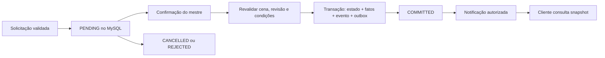

# MI-04 — comandos do grupo e continuidade transacional

> Registro da etapa MI-04. O [copiloto local MI-05](./19-mestre-copiloto.md) já reutiliza estes comandos após aprovação humana. As referências à próxima etapa abaixo descrevem o planejamento desta entrega.

Implementação de 17/10/2026. Complementa a [spec do mestre de IA](./13-mestre-ia-lore.md), o [mundo persistente](./16-mundo-persistente.md) e a [memória](./17-historia-conhecimento.md). O perfil inicial é humano, para **O Pacto dos Três Sinos 1.0.0**. A integração Gemma continua em MI-05.

## Como usar

Na mesa, **Comandos** abre `/campaigns/:id/actions`. Vincule os personagens à cena pelo painel da mesa. O jogador escolhe seu personagem e solicita viagem ou descanso; o mestre vê as solicitações, confere as condições e confirma, recusa ou cancela. Uma solicitação pendente não muda o mundo.

O mestre também pode preparar transporte de objetos de trama e avanço de tempo. Todos os efeitos passam pelo mesmo comando transacional, inclusive quando iniciados pelo mestre. As ações confirmadas aparecem em **Memórias**; jogadores veem somente os acontecimentos autorizados. Abrir um mapa continua sendo navegação visual, sem deslocar o grupo ou os tokens.

Novas instalações preparam os comandos dentro da transação de instalação. Campanhas anteriores mostram **Preparar comandos do cenário**. A preparação exige memória inicial, C07 ainda na versão 1 e caixote/badajo na mina, sem transporte ou recipiente já configurado. Divergências são recusadas para reconciliação explícita; não há reparação automática de uma campanha que já evoluiu manualmente. A base local não continha campanhas com lore ao aplicar esta migration.

## Regras entregues

| Operação | Condições e efeito confirmado |
| --- | --- |
| `TRAVEL` | Uma aresta da rota a partir da cena atual, desbloqueada, duração de 1–1.440 minutos, destino com mapa publicado. Muda a cena, a localização dos objetos carregados e o mapa de exploração dos participantes. Soma a duração **uma única vez**, independentemente do número de personagens. |
| `REST SHORT` | Soma 60 minutos ao relógio, recupera pontos de ação de exploração e reduz fadiga em 1, até zero. Não recupera PV nem espaços de magia. |
| `REST LONG` | Soma 480 minutos uma vez, recupera PV até o máximo, zera PV temporários e uso dos espaços de magia, recupera ações de exploração e zera fadiga. |
| `TAKE_OBJECT` | Mestre escolhe objeto portátil sem recipiente/portador, presente na cena, e personagem ativo do grupo com PV positivo. Atribui o portador e atualiza os fatos associados ao recipiente e conteúdo. |
| `DROP_OBJECT` | Mestre deixa um objeto carregado na cena atual. Retira o portador; o conteúdo permanece no recipiente. |
| `ADVANCE_TIME` | Mestre informa 1–1.440 minutos e motivo público. Atualiza calendário e histórico, sem executar pressões narrativas, clima, pagamentos ou eventos aleatórios. |

Todas exigem cena de exploração, ausência de encontro de combate e pelo menos um personagem vinculado pertencente ao mestre ou a membro atual. Viagem/descanso exigem PV positivo de todos os participantes. O grupo é único: todos os personagens vinculados de membros atuais participam. Não há escolha de subgrupo nesta fase.

As regras de descanso são o perfil simplificado de exploração já adotado pelo projeto, não uma implementação integral de descansos SRD. Cura por dados de vida, interrupções, consumo de suprimentos, limite diário, habilidades específicas de classe e economia dependem de adaptadores posteriores. Não existe comando de recompensa nesta fase.

Campanhas com lore deixam de aceitar viagem/descanso individuais, descanso direto da ficha e alterações livres do relógio/clima. Ticks automáticos ficam desabilitados. Os caminhos antigos retornam orientação para Comandos; campanhas sem lore mantêm seu funcionamento anterior. Outros módulos de ficha/combate continuam manuais; MI-04 não afirma registrar toda edição mecânica feita fora desses comandos.

## Objetos e memória sem onisciência

`CampaignPlotObject` ganha `portable`, `containerEntityId` e `carrierEntityId`, com referências restritas à mesma campanha. Caixote e badajo são portáteis; o badajo começa **dentro do caixote**. Os sinos e a galeria permanecem imóveis. Só recipientes/objetos na raiz podem ser transportados; abrir, esvaziar e reparar objetos ainda não têm comando.

C07 passa a usar `predicate=OBJECT_LOCATION`, vinculado ao badajo. Outros cinco objetos recebem fatos `LOC_<chave>`. Há 33 fatos iniciais, conservando os 28 anteriores e suas observações. C07 mantém sua versão inicial e texto original até o primeiro efeito físico.

Carregar, viajar e deixar atualizam estado físico, fato atual e revisão factual na mesma transação. O evento de viagem fica relacionado aos objetos transportados para recuperação posterior por entidade. Correção/edição narrativa livre não pode alterar fatos vinculados: isso impediria que uma frase contradissesse a localização física. Outras afirmações continuam editáveis segundo as regras MI-03.

Exemplo confirmado no ensaio: carregar o caixote na mina → viajar até a abadia → deixá-lo. Caixote e badajo terminam na abadia; C07 informa a localização atual; o histórico preserva a mina. Mara continua conhecendo a versão da mina, marcada como desatualizada **somente para o mestre**. Obter nova informação exige descoberta explícita. C05/C09 não mudam com acusações ou deslocamentos.

O mestre escolhe `MASTER` ou `PUBLIC` para o acontecimento de pegar/deixar. Publicar esse acontecimento revela seu texto, mas não publica todos os fatos e conteúdos associados. Fatos de localização preservam sua audiência original. Viagem, descanso e passagem de tempo têm relato público; detalhes internos dos efeitos ficam no payload administrativo.

## Solicitação, confirmação e falhas



`GameAction` guarda solicitante, personagem, lugar de origem, revisão da cena, operação validada, chave/hash da requisição, decisão e evento resultante. Transições terminais são imutáveis. Cancelar/recusar antes do commit não gera efeito de mundo. Repetir a mesma decisão terminal retorna o mesmo resultado; tentar outra decisão dá 409.

A chave é única por campanha e solicitante. Reenviar a solicitação idêntica retorna o mesmo ID; reutilizá-la com conteúdo diferente dá 409. A interface conserva a chave após perda de resposta. Há até dez solicitações pendentes por pessoa; a leitura mantém todas as pendentes visíveis, além das últimas cinquenta resolvidas.

`expectedSceneRevision` protege a intenção do jogador. `expectedRevision`, privado do mestre, protege a confirmação. Vincular personagem, viajar, descansar ou avançar tempo invalida solicitações da cena anterior. Atividade privada de objetos não incrementa a revisão pública da cena, evitando revelar segredos por contadores. A confirmação ainda compara a revisão global e revalida portador/localização.

Escritas usam transação serializável e bloqueio da linha da campanha, com repetição limitada para conflito transacional. Estado, calendário, exploração, revisões factuais, evento, status da ação e outbox são gravados juntos. Falha antes do commit mantém a solicitação pendente e não deixa efeito parcial. Nenhuma transação fica aberta aguardando decisão humana ou inferência.

Identidade vem do JWT. O controlador constrói `ActorContext.USER`; campos extras e operações fora do schema são recusados. Jogadores só propõem viagem/descanso por personagem próprio e só cancelam solicitações próprias. Apenas o mestre confirma/recusa. `AI_MASTER` existe como contrato, mas é explicitamente recusado até a política MI-05. O modelo não recebe SQL nem credenciais do banco.

## Entrega durável e atualização das telas

`OutboxEvent` tem relação única com o evento, estados `PENDING/PROCESSING/DELIVERED`, tentativas, próxima tentativa e concessão de processamento de 30 segundos. O worker roda a cada dois segundos, reivindica até cinquenta eventos por lote, recupera concessões expiradas e recua após falha até cinco minutos. Eventos novos de MI-03 também usam essa fila.

Antes da emissão, o worker consulta membros atuais e audiência dentro de uma transação. O gateway usa salas individuais existentes em `/vtt`, verifica identidade e expiração do JWT. O pacote `story:updated` contém **apenas `{ campaignId, eventId }`**; não contém texto, contagem ou revisão global. Uma remoção de membro impede entrega subsequente mesmo com socket ainda conectado.

É uma fila durável de **invalidações**, não confirmação de leitura por cada navegador. Pode haver entrega repetida se o processo cair após emitir; o cliente deduplica IDs. `DELIVERED` significa tentativa de despacho concluída, inclusive quando ninguém está conectado. Ao reconectar, o navegador consulta o snapshot autorizado. O polling HTTP continua como recuperação: cinco segundos em Comandos, dez em Memórias/painel da cena, enquanto visíveis. A cena também atualiza a store do calendário da mesa, usada pelo relógio e iluminação.

Preparar/cancelar/recusar uma solicitação não cria evento narrativo; essa fila aparece por recarga HTTP. Reconectar nunca repete um efeito. Não há narração por modelo nesta etapa: o resultado textual do servidor é o relato confirmado.

## APIs

Prefixo `/api`, JWT obrigatório e respostas sem cache.

| Método/rota | Contrato |
| --- | --- |
| `GET /campaigns/:id/game-actions/state` | Cena, relógio, participantes, rotas disponíveis e solicitações autorizadas. Mestre recebe revisão global e objetos; jogador recebe somente ações próprias e rotas para mapas publicados. |
| `POST /campaigns/:id/game-actions/initialize` | Mestre prepara domínio de instalação anterior compatível, idempotentemente. |
| `POST /campaigns/:id/game-actions` | `{ requestKey, expectedSceneRevision, characterEntityId?, operation }`. Só cria solicitação. |
| `POST /campaigns/:id/game-actions/:actionId/resolve` | `{ decision: COMMIT|CANCEL|REJECT, expectedRevision?, reason? }`. Revisão global obrigatória para confirmar uma ação ainda pendente. |

## Verificação e operação

Migration aditiva: `20261017020000_group_actions`. Adiciona duas tabelas e campos/índices/FKs nas tabelas existentes. Backup anterior em `backend/backups/lore-migration/2026-10-17T16-16-31.665Z/`: 57 tabelas, 3.451 registros, schema anterior e snapshot. Credenciais ficam fora dos relatórios.

Aplicada em `localhost:3306/rpg`: **59 tabelas de aplicação**, sem divergência entre schema e banco. Os **3.451 registros das 57 tabelas anteriores preservaram hashes idênticos**, conferidos antes e depois da migration. Nenhuma campanha real foi criada ou alterada pelos testes. Builds de backend/frontend, lint dos arquivos alterados, 66 testes existentes, regressões MI-02/MI-03, integração MI-04 e navegador foram verificados. O catálogo continua com 16/16 referências resolvidas.

O ensaio usa MySQL descartável: aplica migrations, restaura o backup, compara hashes e executa instalação MI-02, memória MI-03 e comandos MI-04. A suíte MI-04 cobre viagem com quatro personagens, duas ações concorrentes sobre o caixote, contenção, fato/localização, conhecimento antigo do NPC, cancelamento, descanso, combate/PV inválido, rota bloqueada/mapa privado, identidade/campanha indevida, remoção de membro e falha injetada após escritas parciais. Outro processo Node recupera estado confirmado e concessão expirada do outbox sem reaplicar ações.

O teste no navegador cobre jogador propondo ação, repetição após perda de resposta, aprovação do mestre, relógio compartilhado, sockets públicos/privados, reconexão, remoção de membro e layouts desktop/celular. Capturas locais em `backend/backups/game-actions-browser/`. Isso não substitui a sessão humana prolongada prevista na spec.

Comandos em `backend`, com frontend de produção na porta 3100 para o teste visual:

```sh
npm run build
npm test -- --runInBand
node scripts/story/run-rehearsal.cjs
node scripts/game-actions/run-rehearsal.cjs
node scripts/game-actions/run-rehearsal.cjs --browser
```

`npm run test:game-actions` exige `DATABASE_URL` numa base `rpg_lore_check_<timestamp>` com migrations e catálogo; o wrapper usa a referência do backup local. Playwright pode ser indicado por `LORE_PLAYWRIGHT_MODULE`. Testes de escrita recusam `rpg`. Para repetir o ensaio após remover sua base descartável, executar `node scripts/lore/migration.cjs rehearse` antes dos wrappers. Preservar o backup.

Não reverter a migration apagando registros de história. Se precisar voltar temporariamente ao código anterior, conservar o schema; qualquer restauração integral deve primeiro ser ensaiada numa base separada. Reconciliação de uma localização física incorreta exige procedimento próprio, ainda sem interface de correção de domínio.

## Próxima etapa

MI-05: identificar hardware/servidor local disponível, configurar provedor Gemma, recuperar contexto autorizado do MySQL e gerar propostas limitadas para revisão do mestre. A política de IA deverá validar capacidades, pausa, evidências e estado atual antes de chamar estes comandos. Inferência, embeddings, resumo automático, diálogos autônomos, rolagens pendentes, recompensas, reparo dos sinos e combate/economia normalizados ainda não fazem parte desta entrega.
